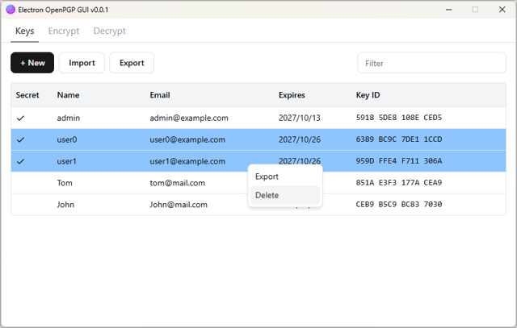
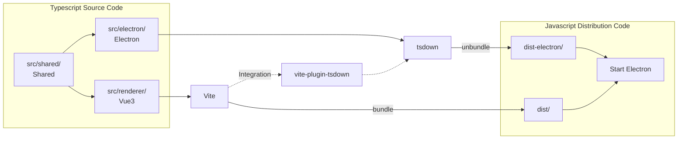
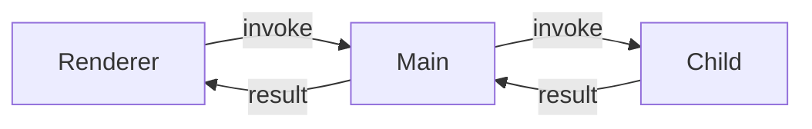

# Electron OpenPGP GUI

一個 Vite + Vue3 + Typescript 的 Electron Desktop App，具有 OpenPGP 金鑰管理與基本檔案加解密功能。此專案用於個人研究 Electron 如何整合 vite 前端架構、主子程序通訊機制、以及各項基礎建設。

## App Features



- PGP key pairs 建立與管理，支援匯入、匯出
- 支援 os 原生風格的 shift + click 範圍選取，以及 ctrl (cmd) + click 加、減選操作
- 使用 PGP key 做檔案加、解密，支援直接拖曳檔案
- 解密預覽 Recipients 資訊

## Tech Stack

| Category     | Technologies                   |
| ------------ | ------------------------------ |
| Language     | Typescript 6                   |
| Desktop      | Electron                       |
| Database     | SQLite, MikroORM               |
| Frontend     | Vue 3, shadcn-vue, Tailwind    |
| Bundler      | Vite, tsdown, electron-builder |
| Cryptography | OpenPGP.js                     |
| Tooling      | pnpm, Oxc                      |

## Download Unsigned App

在 [Release](https://github.com/Lastor-Chen/electron-openpgp-gui/releases/latest) 頁面下載對應平台的 Desktop App。

| System      | File                                      |
| ----------- | ----------------------------------------- |
| Windows x64 | OpenPGP-GUI-{version}-windows-x64.exe.zip |
| MacOS arm64 | OpenPGP-GUI-{version}-mac-arm64.dmg       |
| MacOS x64   | OpenPGP-GUI-{version}-mac-x64.dmg         |

注意，此 App 為非正式產品，沒有做 code signing，從網路下載時會被 OS 標記為未信任來源並限制啟動。<br>
請參考下列方式去強制啟動 App，或是直接 git clone 此專案以 dev 執行。

### Windows

解壓縮後，是一個免安裝的 portable exe，直接 Double-click 啟動。

執行網路下載的 unsigned exe 時 Windows 會跳出警告，請選擇「其他資訊」->「仍要執行」。

### MacOS

Double-click dmg 開啟，滑鼠拖曳 App 圖標至 Applications 資料夾後，右鍵 -> 退出，於啟動台開啟 App。

開啟 unsigned app 時會報出「已損毀」錯誤。請在終端機輸入以下指令來移除 quarantine 標籤，再重新開啟 App。

```shell
xattr -dr com.apple.quarantine /path/to/app
```

可參考 electron-builder 官方文件 [macOS-Specific](https://www.electron.build/docs/troubleshooting/#macos-specific) 關於「**App is damaged and can't be opened**」的說明。

## Uninstallation

Windows 直接刪除 portable exe。MacOS 直接刪除 app。

Electron 會在 OS 特定的 user path 中儲存 Chromium 本地資料，此 App 的 sqlite 也放在這。需手動刪除下列位置的 `electron-openpgp-gui` 資料夾。

```
# windows
C:\Users\<user>\AppData\Roaming\electron-openpgp-gui\

# mac
/Users/<user>/Library/Application Support/electron-openpgp-gui/
```

## Start Development

- Node.js >= v24.22.1
- pnpm >= v11

Clone this repo.

```
git clone https://github.com/Lastor-Chen/electron-openpgp-gui.git
cd electron-openpgp-gui
```

Install dependencies.

```
pnpm install
```

Start with vite dev server.

```
pnpm dev
```

## Project Structure

```
root/
  dist/                      # vite build renderer output (git ignored)
  dist-electron/             # tsdown build electron output (git ignored)
  release/                   # electron-builder build output (git ignored)
  src/
    electron/
      child/                 # electron UtilityProcess 子程序
        apiAgent/sqlite      # sqlite module
      main/                  # electron 主程序與進入點
      preload/               # electron preload scripts
    renderer/                # frontend vite vue3 app
      components/ui/         # shadcn-vue
    shared/
      utility-bridger/       # 自製子程序通訊 module
  vite-plugin-tsdown/        # 自製 vite plugin 整合 vite 與 electron
```

## Technical Highlights

- 使用 package.json 新的 `devEngines.packageManager` 實現 only allow pnpm
- 使用 TypeScript Project References 整合 node.js 與 browser tsconfig，一次性 type check
- 使用 Oxc 做 linter 與 auto formatter，降低大量 eslint / prettier plugins 設定造成的負擔
- 自製 `vite-plugin-tsdown` 將 electron ts 編譯納入 vite dev 一起 HOT Reload
- 支援 `.node-version` 自動切換 node.js 版本 (需 node.js 版本管理器有支援)
- Electron Renderer 與 Child、Main 之間的 type-safe IPC 通訊機制包裝
- MikroORM runtime migration 機制
- 使用 Vue3 + shadcn-vue + tailwind 搭建前端 Renderer

### vite-plugin-tsdown



自製的 vite plugin，將 tsdown 接入 vite 生命週期，讓 electron 或其他 node.js app 能接入前端，由 vite 主導用一個終端機執行，一同享有相同的熱更新體驗。

- 用 tsdown 更靈活的編譯、打包 electron 端 ESM、CJS typescript
- 讓 tsdown 與 vite dev 一起 watch changes rebuild
- 繼承 vite importMetaEnv，讓 node.js 端也能使用 vite 提供的 `import.meta.env`
- 額外的 `onAllSuccess` hook 與 `viteWatch` 設定，補足 tsdown 沒有 afterBuilds hook 的缺點
- 提供封裝好的 `spawnElectron()` 做 electron 的 watch restart

[See Usage](./vite-plugin-tsdown/README.md)

### utility-bridger 子程序通訊機制



`src/shared/utility-bridger/`

使用 electron UtilityProcess 建立子程序，用於執行 Native API 或較重的運算，不阻塞 electron 主程序。並對其做一層方便使用的 type-safe 包裝，需增加子程序時，也可快速復用。

- type-safe API 定義，享有智能提示，改 API 時能透過 `pnpm run typecheck` 快速找出哪邊有用到
- UtilityProcess 不像 node:child_process，能避免主程序關閉，子程序還殘留的問題
- 支援 child 主動發送事件，在 Vue 透過 `createChildRef()` 包裝成 `ref`，讓 child 能 trigger Vue re-render
- 會在 Browser devtools 顯示呼叫 logger 方便 debug

在 Vue 中的使用範例。

```vue
<script>
// 接收 child 事件值, 存成 vue ref
const myChildRef = createChildRef<MyChildApis, MyChildEvents>('childName')
const state = myChildRef('eventName')

// 呼叫 child API
const myChild = wrapRpcChild<MyChildApis, MyChildEvents>('childName')
const onClick = async () => {
  const result = await myChild.someApi('argA')
}
</script>

<template>
  <button @click="onClick">Click {{ state }}</button>
</template>
```

[See Usage](./src/shared/utility-bridger/README.md)

### SQLite runtime migration

`src\electron\child\apiAgent\sqlite`

Desktop App 不同於一般 Web App，SQLite db 是存在每個 user 自己的電腦上。所以 db schema 變更時，必須要能在 App 啟動時 runtime 檢查 db 並進行 migrate。

- 借用 FourCC 概念建立專屬 sqlite application_id，識別 db file 是不是自己的
- 走 Migration first 第一筆 schema 就建立 migration file 並打上 application_id
- 透過 mikro-orm cli 自動根據 schema diff 產生純 SQL 的 migration file
- 在 app 啟動時，用 application_id 以及 migration history 判斷是否需要更新

#### Why MikroORM

此 App 使用 MikroORM 的 programmatic migration API，其內部使用 Sequelize 推出的 [Umzug](https://github.com/sequelize/umzug)。

同時它也支援新版 node.js 的原生 node:sqlite，相比其他 driver 不用處理麻煩的 native binary 打包問題。

[See Migration Usage](./src/electron/child/apiAgent/sqlite/README.md)
