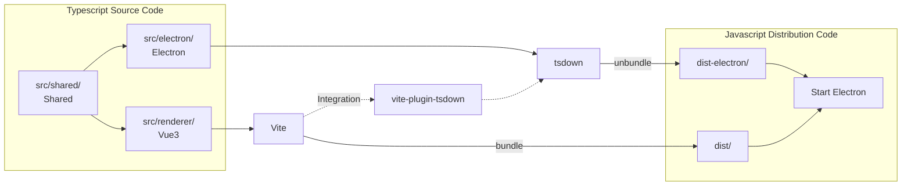
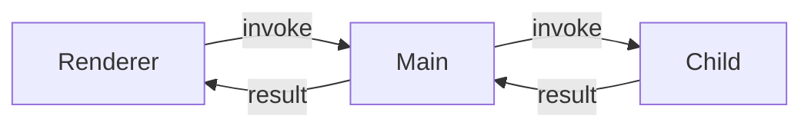

# Electron OpenPGP GUI

一個 Vite + Vue3 + Typescript 的 Electron Desktop App，具有 OpenPGP 金鑰管理與基本檔案加解密功能。此專案用於個人研究 Electron 如何整合 vite 前端架構、主子程序通訊機制、以及各項基礎建設。

TODO

- [ ] App 截圖
- [x] App Features 太過細節
- [x] Tech Keywords 改 Tech Stack 表格, 搬到前面
- [x] 搬移 usage example
- [x] 改 Overview 前言
- [x] build 流程圖
- [x] IPC 流程圖
- [ ] Boilerplate Features -> 改為 Technical Highlights
- [ ] Remove App 簡化, 改為 Uninstallation

## App Features

(圖)

- PGP key pairs 建立與管理，支援匯入、匯出
- 支援 os 原生風格的 shift + click 範圍選取，以及 ctrl (cmd) + click 加、減選操作
- 使用 PGP key 做檔案加、解密，支援直接拖曳檔案
- 解密預覽 Recipients 資訊

## Tech Stack

| Category     | Technologies                   |
| ------------ | ------------------------------ |
| Language     | Typescript 6                   |
| Desktop      | Electron                       |
| Database     | SQLite, MikroORM               |
| Frontend     | Vue 3, shadcn-vue, Tailwind    |
| Bundler      | Vite, tsdown, electron-builder |
| Cryptography | OpenPGP.js                     |
| Tooling      | pnpm 11, Oxc                   |

## Download Unsigned App

在 [Release](https://github.com/Lastor-Chen/electron-openpgp-gui/releases/latest) 頁面下載對應平台的 Desktop App。

| System      | File                                      |
| ----------- | ----------------------------------------- |
| Windows x64 | OpenPGP-GUI-{version}-windows-x64.exe.zip |
| MacOS arm64 | OpenPGP-GUI-{version}-mac-arm64.dmg       |
| MacOS x64   | OpenPGP-GUI-{version}-mac-x64.dmg         |

注意，此 App 為非正式產品，沒有做 code signing，從網路下載時會被 OS 標記為未信任來源並限制啟動。<br>
請參考下列方式去強制啟動 App，或是直接 git clone 此專案以 dev 執行。

### Windows

解壓縮後，是一個免安裝的 portable exe，直接 Double-click 啟動。

瀏覽器直接下載 unsigned 的 exe 會被鎖定，需手動選擇「保留」->「仍要保留」後才會實際寫入到下載位置，因此打包成 zip 繞過瀏覽器的機制。解壓縮並執行 unsigned exe 時 Windows 會跳出警告，選擇「其他資訊」->「仍要執行」。

### MacOS

Double-click dmg 開啟，滑鼠拖曳 App 圖標至 Applications 資料夾後，右鍵 -> 退出，於啟動台開啟 App。

開啟 unsigned app 時會報出「已損毀」錯誤。請在終端機輸入以下指令來移除 quarantine 標籤，再重新開啟 App。

```shell
xattr -dr com.apple.quarantine /path/to/app
```

可參考 electron-builder 官方文件 [macOS-Specific](https://www.electron.build/docs/troubleshooting/#macos-specific) 關於「**App is damaged and can't be opened**」的說明。

## Remove App

Windows 直接刪除 portable exe。MacOS 直接刪除 app。

然而 Electron 會在不同 OS 特定的 user path 中儲存 Chromium 的本地資料，此 App 的 sqlite 也放在此位置。需手動刪除下列位置的 `electron-openpgp-gui` 資料夾。

```
# windows
C:\Users\<user>\AppData\Roaming\electron-openpgp-gui\

# mac
/Users/<user>/Library/Application Support/electron-openpgp-gui/
```

## Development Start

- Node.js >= v24
- pnpm >= v11

### Clone this repo

```
git clone https://github.com/Lastor-Chen/electron-openpgp-gui.git
cd electron-openpgp-gui
```

### Install dependencies

```
pnpm install
```

### Start development

```
pnpm dev
```

## Project Structure

```
root/
  dist/                      # vite build renderer output (git ignored)
  dist-electron/             # tsdown build electron output (git ignored)
  release/                   # electron-builder build output (git ignored)
  src/
    electron/
      child/                 # electron UtilityProcess 子程序
        apiAgent/sqlite      # sqlite module
      main/                  # electron 主程序與進入點
      preload/               # electron preload scripts
    renderer/                # frontend vite vue3 app
      components/ui/         # shadcn-vue
    shared/
      utility-bridger/       # 自製子程序通訊 module
  vite-plugin-tsdown/        # 自製 vite plugin 整合 vite 與 electron
```

Multi-target build pipeline 示意圖



## Technical Highlights

- 使用 package.json 新的 `devEngines.packageManager` 實現 only allow pnpm
- 使用 TypeScript Project References 整合 node.js / browser tsconfig，一次性 type check
- 使用 Oxc 做 linter 與 auto formatter，降低大量 eslint / prettier plugins 設定造成的負擔
- 自製 `vite-plugin-tsdown` 將 electron ts 編譯納入 vite dev 一起 HOT Reload
- 支援 `.node-version` 自動切換 node.js 版本 (需 node.js 版本管理器有支援)
- Electron Main 與 Renderer type-safe IPC 通訊封裝
- Electron UtilityProcess 與 Renderer type-safe RPC 通訊架構，執行 Native API 或較重的 functions
- Electron UtilityProcess 通訊 devtools debug logger 機制
- MikroORM runtime migration 機制
- 使用 Vue3 + shadcn-vue + tailwind 搭建前端 Renderer UI

### vite-plugin-tsdown

- 使用 tsdown 編譯 electron typescript
- 將 tsdown build 併入 vite 生命週期，一起 dev watch re-build
- 提供封裝好的 `spawnElectron()` 做 electron 的 watch re-start
- 繼承 vite importMetaEnv

[See Usage](./vite-plugin-tsdown/README.md)

### utility-bridger 子程序 RPC 通訊機制



使用 electron UtilityProcess 建立子程序，並對其做一層 type-safe 的 RPC 包裝，讓 renderer 可以方便的呼叫 child 提供的 API。需增加子程序時，也可快速復用。

- 與主程序隔離，用於執行 Native API 或較重的運算，不阻塞 electron 主程序
- 使用 electron UtilityProcess 建立子程序, 自動跟隨 electron main 關閉
- 統一定義 child API type，讓 renderer 能智能推斷，並進行程式化 type check
- 可從 main / renderer 或不同 child 之間，呼叫 child API
- 可從 child 發送事件，於 main / renderer 或其他 child 接收、執行 callback
- 將 child 發送的事件值，於 renderer 包裝成 Vue ref，讓 child 能主動 trigger 前端 re-render
- Browser devtools debug logger

[See Usage](./src/shared/utility-bridger/README.md)

### Sqlite runtime migration

- Migration first，第一筆 schema 就建立 migration file
- 第一筆 migration 會建立 sqlite application_id，便於匯出、匯入識別用
- 透過 mikro-orm cli 自動根據 schema diff 產生純 SQL 的 migration file
- 在 app 啟動時，檢查 application_id 以及 migration history 判斷是否需要更新

#### Why MikroORM

因為它支援 node.js 原生 node:sqlite，以及 programmatic migration (內部用 Umzug)。

Desktop App 不同於一般 Web App，database 是存在每個 user 自己的電腦上。所以 db schema 變更時，必須要能在 App 啟動時，runtime 進行 migrate。

node-sqlite、better-sqlite3 或 libsql 等 driver 都是 native binary，搭配 electron 在 build app 時，容易出現各種 native 打包問題。使用 node.js v24 新的原生 node:sqlite 可避開煩人的 native 打包問題，因此選擇有支援 node:sqlite 的 ORM。

Driver memo:

- node-sqlite - 已不再維護
- better-sqlite3 - 使用 ABI 編譯，node.js 與 electron 不兼容，需要用 @electron/rebuild 重編
- libsql - 自動根據當前 cpu 架構下載 binary，難以 build mac universal，且 windows 會有關不乾淨 db 被 lock 的問題

ORM memo:

- Sequelize - 僅支援 node-sqlite
- Prisma - migration 一定要用 cli，且 package size 相當肥
- Drizzle - 較肥，更偏 Query Builder
- TypeORM - 用 stage2 Class 裝飾器，不考慮

#### Migrate by mikro-orm cli

mikro-orm cli 能夠根據 sqlite schema 變更的 diff 自動生成 migration SQL。但需注意 sqlite 本身有限制，少數情況生成的 SQL 可能不堪用。

1. 設定 DB_PATH 環境變數

cli 不是透過 electron 啟動，無法取得 electron user path，所以使用環境變數做設定。在根目錄建立 `.env` 檔案，設定 DB_PATH。

```
# mac
DB_PATH="/Users/<user>/Library/Application Support/electron-openpgp-gui/pgp_data"

# windows
DB_PATH="C:/Users/<user>/AppData/Roaming/electron-openpgp-gui/pgp_data"
```

2. 修改 `src/electron/child/apiAgent/sqlite/schemas` 定義

```ts
export const SomeSchema = defineEntity({
  // ...
  properties: {
    // add or modify
    some: p.text().nullable(),
  },
})
```

3. 執行 mikro-orm cli 生成 migration file

```
pnpm exec mikro-orm migration:create
```

4. 將 `src/electron/child/apiAgent/sqlite/migrations` 生成的 file 引入到 mikro-orm config

```ts
// src/electron/child/apiAgent/sqlite/config.ts
import { MigrationXXXX } from './migrations/MigrationXXXX.ts'

defineConfig({
  // ...
  migrations: {
    migrationsList: [
      // ...
      MigrationXXXX, // add it
    ],
  },
})
```

5. dev 啟動 app 確認 migration 是否成功，終端機會顯示相關 logs

```bash
[migrator] Processing 'MigrationXXXX'
[migrator] Applied 'MigrationXXXX'
```

6. 對新增的 migration file 做 oxfmt format，將其與 `.snapshot-{db_name}.json` 的變更一起 git commit

`.snapshot-{db_name}.json` 是 mikro-orm cli 判斷 schema 差異用的記錄檔，需要一起進 git 版控。打包後的 dist 不需要包含。

更多資訊: [MikroORM Snapshots](https://mikro-orm.io/docs/migrations#snapshots)
